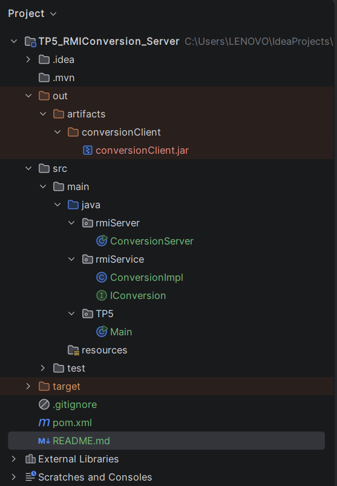
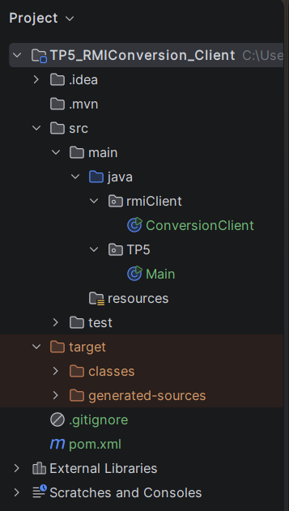
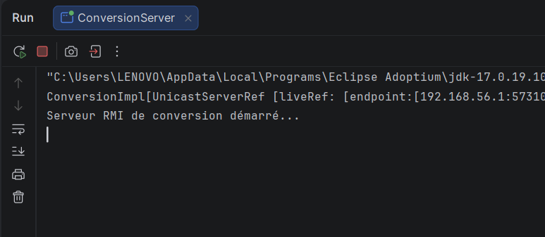
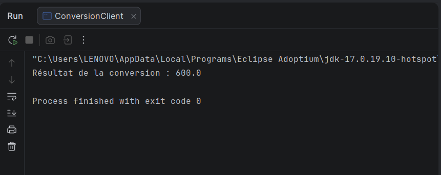

# TP 5 : Invocation des méthodes sur des objets distants avec Java RMI

## Objectif du TP

Concevoir une application répartie fournissant un service de conversion de devises avec Java RMI (Remote Method Invocation). Le serveur offre aux clients la possibilité de convertir un montant en euros vers le dinar. Ce TP permet de comprendre le cycle de vie d'un service distant : définition de l'interface, implémentation, enregistrement dans l'annuaire RMIRegistry et invocation par le client.

---

## 1. Arborescence du projet serveur

## 2. Création du fichier jar

Depuis le projet serveur, le package `rmiService` a été exporté dans un fichier `conversionClient.jar` qui contient uniquement l'interface `IConversion` . Ce jar est le seul élément que le client reçoit : il connaît le contrat du service, mais pas son implémentation, qui reste côté serveur.

## 3. Arborescence du projet client

### Console du serveur

Le serveur démarre le RMIRegistry, crée l'objet `ConversionImpl` et le publie dans l'annuaire.

### Console du client

Le client cherche l'objet distant dans l'annuaire puis invoque `convertirMontant`. Le résultat de la conversion s'affiche dans la console.

